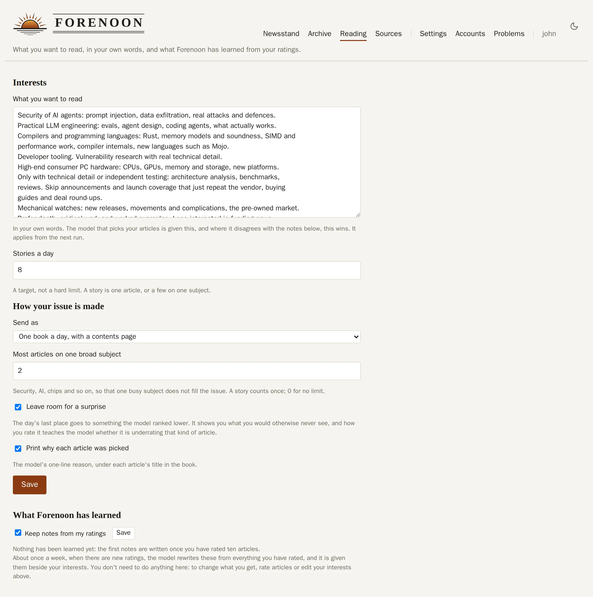
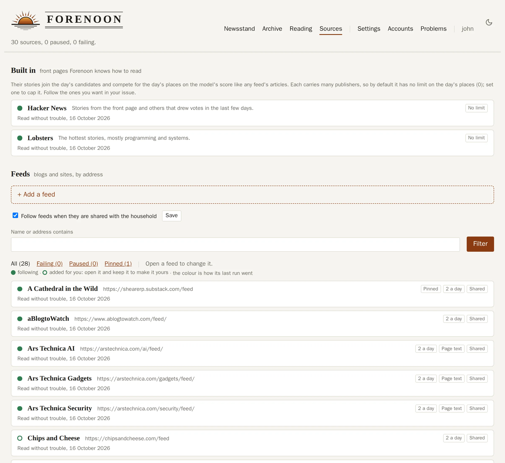
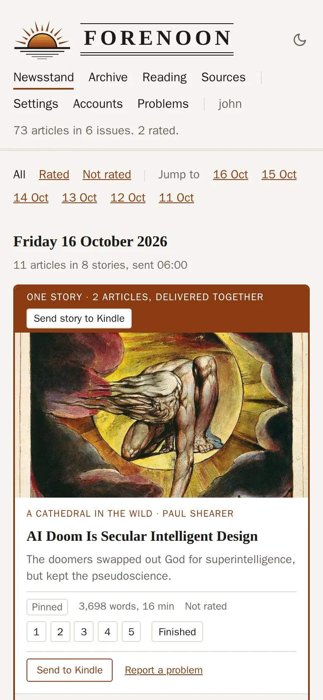
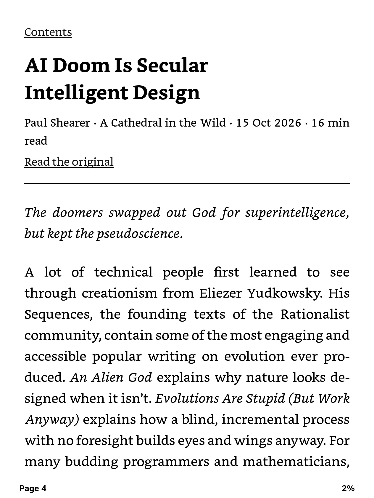
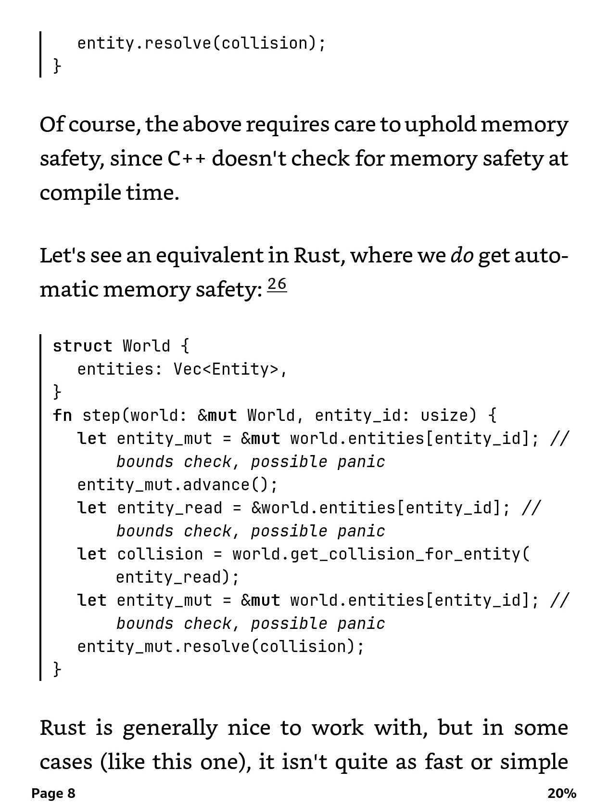

# Forenoon

**[forenoon.dev](https://forenoon.dev)** · see a live newsstand:
[Mara](https://mara.forenoon.dev) · [Theo](https://theo.forenoon.dev) · [June](https://june.forenoon.dev)


Forenoon is made to cut the time you spend scrolling, find the writing you actually care
about, and make your e-reader useful for more than books. Reading on e-ink, away from a
feed, helps with the scrolling too.

Other aggregators exist. They are paid for by ads or pushed along by an agenda, and they
know far less about what you want. Forenoon runs on your own machine and has one job:
find what you would choose to read, and put it where you read best.

Every morning it reads your RSS feeds, including those of the publications you subscribe to,
and searches aggregation sites (Hacker News, Lobsters). A model (Claude, or one on your own
server) chooses from all of it against a plain-English description of your interests, and the result is emailed
to your Kindle as one book with a contents page. Each article ends with rating links, so
you can say what you thought without leaving your e-reader, and your ratings shape the next
day's choices.

<picture>
  <source media="(prefers-color-scheme: dark)" srcset="web/site/images/newsstand-dark.webp">
  
</picture>

## What it does

- **Chooses by reading, not by headline.** Every candidate is ranked from its title and
  opening; the best 40 are then read in full before the day is chosen, so a teaser with a
  good title loses to an article with something in it.
- **Learns from you.** Rate 1 to 5 from the Kindle or the web pages, with an optional
  one-tap reason. Describe your interests in your own words and change them whenever you like.
- **Stories, not links.** A short post that only points at an article is replaced by the
  article. Several reports of one event share one place in the day.
- **Your subscriptions.** Publications you pay for come in through their feeds; the articles
  chosen are read signed in as you, with your own browser's cookie for the site.
- **A newsstand and an archive.** Web pages show each day's issue, and everything the
  model considered and passed over, with its reasons. Filter by source, rating, date or how
  an article arrived; send anything to the Kindle as a book of its own.
- **Add your own.** Paste a link to put it in tomorrow's issue, send it now, or file
  something you have already read along with your rating.
- **Clean books.** Articles are stripped to their text and pictures, with code and tables
  kept readable on e-ink. No scripts, trackers or remote content reach the device.
- **Cheap to run.** One measured day: 23 sources including a whole Financial Times, about
  165 candidates ranked, 40 read in full, 8 stories delivered in 80 seconds, for **about
  two cents** of Claude Haiku. Or nothing: any OpenAI-compatible server works too (Ollama,
  LM Studio, llama.cpp, vLLM, or OpenAI itself), and a local Qwen3.8-27B on one RTX 4090
  ranks and reads that day in about five minutes. If a model server cannot be reached as a
  run starts, it moves to a fallback model; with none, or when the day's tokens are spent, it still delivers: pinned
  sources first, then the newest articles in turn across sources.
- **No one else's incentives.** No ads, no engagement metrics, no telemetry. Your sources,
  ratings and articles are one SQLite file and a folder on your own machine. What leaves it
  is what the choosing needs: your interests and the articles' text, sent to the model
  provider you hold the key for, or to nobody when the model runs on your own network. The web pages are public behind a login; only the signed
  rating links in each book work without one.

Everything is set up in the browser: sources, interests, delivery time and the rest.

What it does today is described in full in [docs/PRD.md](docs/PRD.md).

## Screens

What you want to read, in your own words, and how your issue is made:

<picture>
  <source media="(prefers-color-scheme: dark)" srcset="web/site/images/reading-dark.webp">
  
</picture>

Sources: feeds the household shares or keeps private, Hacker News and Lobsters built in,
and where each article's text comes from:

<picture>
  <source media="(prefers-color-scheme: dark)" srcset="web/site/images/sources-dark.webp">
  
</picture>

On a phone:

<picture>
  <source media="(prefers-color-scheme: dark)" srcset="web/site/images/phone-dark.webp">
  
</picture>

On the Kindle: the day's issue in the library, its contents with stories grouped and the
reason for each pick, and an article:

<p>
  
  
  
</p>

Code in a monospaced font, with long lines wrapped under their own indent rather than cut off:



## Run it locally

```sh
uv sync
mkdir -p run/data
export FORENOON_DATA_DIR=run/data FORENOON_FEEDBACK_SECRET=$(openssl rand -hex 32)
export FORENOON_ANTHROPIC_API_KEY=sk-ant-...  # the model chooses the articles; or a local
                                              # one: FORENOON_LLM_LAN_URL=http://gpu-box:8080/v1

# a reader to deliver to; asks for a password for the web pages
(cd web && cargo run -- --db ../run/data/forenoon.sqlite3 add-user me --email you@example.com --kindle you@kindle.com)
# the web pages: sign in at http://127.0.0.1:8081/ and add feeds on Sources; stop with Ctrl-C
(cd web && cargo run -- --db ../run/data/forenoon.sqlite3 serve --listen 127.0.0.1:8081)

uv run forenoon report                          # per-source extraction report
uv run forenoon run --dry-run --out run/out     # build EPUBs, send nothing
uv run forenoon golden --out run/out                           # rendering test file for the device
```

To deliver for real, set the mail server in the environment (`FORENOON_SMTP_HOST`,
`FORENOON_SMTP_USERNAME`, `FORENOON_SMTP_SENDER`, `FORENOON_SMTP_PASSWORD`) and run
`forenoon run`. What belongs to the deploy is in the
environment (`deploy/.env.example` lists it all), and everything else is set on the web
pages and kept in the database.

| Command                                            | What it does                                                                                                               |
| -------------------------------------------------- | -------------------------------------------------------------------------------------------------------------------------- |
| `forenoon report`                                  | Extracts the latest items of every source and prints clean / degraded / failed with reasons. Delivers and records nothing. |
| `forenoon run [--dry-run] [--out DIR] [--user ID]` | One delivery now. Safe to rerun: nothing is sent twice and the daily cap holds.                                            |
| `forenoon schedule`                                | Runs `forenoon run` every day at the delivery time. This is the container's default command.                               |
| `forenoon feedback-log`                            | Prints the logged feedback.                                                                                                |
| `forenoon send-queue`                              | Fetches the links readers added and sends what they asked for on the web pages. The scheduler does this every minute.      |
| `forenoon golden`                                  | Writes a test EPUB with code, tables, lists and an image.                                                                  |

Checks on the device have two helpers in `tools/`, outside the container: `send_epub.py` emails
one EPUB to a Kindle address with the mail settings from the environment, and
`measure_screenshot.py` prints the left edge of each text row of a Kindle screenshot, in pixels.

## Deploy

`deploy/docker-compose.yml` runs the pipeline, the web pages and (optionally) a Cloudflare
Tunnel and the browser for subscriber sessions. The web pages are a separate Rust program in
`web/`, served over https behind a login: the newsstand, the archive, sources, settings and
your account. They also answer the rating links in each book, which need no login. Setup guides:

- [docs/setup-email.md](docs/setup-email.md): SMTP relay and Amazon's approved sender list
- [docs/setup-deploy.md](docs/setup-deploy.md): compose on a NAS, Cloudflare Tunnel or your own proxy, backups
- [docs/setup-sessions.md](docs/setup-sessions.md): sites you subscribe to, read signed in as you (optional)

What has gone wrong with books on the Kindle, and the rules that came from it:
[docs/kindle-books.md](docs/kindle-books.md).

## Security notes

- All fetched content is untrusted. Article HTML is reduced to an allowlist of elements and
  attributes; scripts, iframes, forms, styles and remote resources never reach the EPUB.
  Images are re-encoded and embedded.
- Recipients come only from readers' own accounts. Nothing in a feed or
  article can choose one.
- The fetcher refuses non-public addresses, on redirects too. This check does not stop DNS
  rebinding, so do not give the container network access to anything sensitive.
- Rating links carry an HMAC-signed, expiring token. They need no login, are idempotent and
  are rate limited.
- The web pages need a login by email address (Argon2id password hashes, limited sign-in
  attempts) and show each reader only their own articles. A forgotten password is reset
  through a link emailed to a confirmed address. Behind https the session cookie is secure
  and host-only, and the sign-in limits use the client address the proxy reports, believed
  only from the proxy.

## Development

```sh
uv run pytest
uv run ruff check . && uv run ruff format --check .
git config core.hooksPath .githooks   # once: prettier-formats staged Markdown on commit
```

The web pages (`web/`, Rust):

```sh
cd web
cargo test
cargo fmt --check && cargo clippy --all-targets -- -D warnings
./dev-db.sh   # after changing a query, a migration or the pipeline's schema: refreshes .sqlx
```

Their SQL is checked at build time against saved query data in `web/.sqlx`, so no database
is needed to build. `web/pipeline-schema.sql` is a copy of the pipeline's tables; a Python
test fails when it differs from `app/store.py`.
